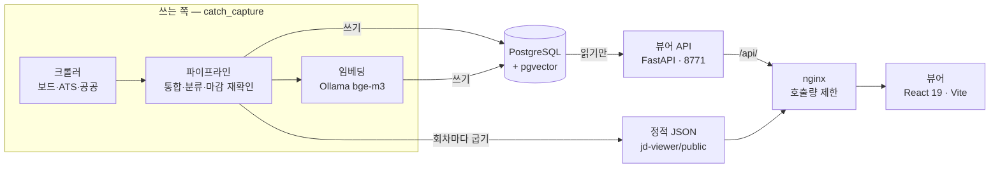

# jobseeker · devgonggo

> 개발자 채용 공고를 **한곳에 모으고, 지금도 열려 있는지 확인해서, 회사 단위로 보여 주는** 서비스.

원티드·점핏·잡코리아·사람인·데보션 같은 5대 보드에 더해 회사 채용 페이지(Greenhouse·Lever·Ashby,
토스·카카오·네이버 등 그룹 포털)와 공공 보드까지 크롤링한다. 모은 공고는 정본 DB(PostgreSQL)에
쌓고, 뷰어(`jd-viewer`)와 뷰어 API(`backend`)로 보여 준다.

작업 규칙과 설계 근거 전체는 [`CLAUDE.md`](CLAUDE.md)에 있다. 이 문서는 **화면을 왜 이렇게
만들었는지**(디자인)와 **백엔드가 실제로 어떻게 동작하는지**를 정리한다.

---

## 목차

1. [전체 구조](#1-전체-구조)
2. [디자인 — 무엇을, 왜 이렇게 만들었나](#2-디자인--무엇을-왜-이렇게-만들었나)
3. [프론트엔드 퍼블리싱 규칙](#3-프론트엔드-퍼블리싱-규칙-jd-viewer)
4. [백엔드 — 뷰어 API 상세](#4-백엔드--뷰어-api-상세-backend)
5. [정본 DB](#5-정본-db-db)
6. [폴더](#6-폴더)
7. [실행](#7-실행)

---

## 1. 전체 구조



핵심 원칙은 세 가지다.

| 원칙 | 내용 | 이유 |
|---|---|---|
| **쓰기와 읽기를 나눈다** | DB 에 쓰는 건 파이프라인(`catch_capture`)뿐, 백엔드는 **읽기만** 한다 | 크롤이 깨져도 화면은 살아 있고, 화면 트래픽이 크롤을 막지 않는다 |
| **API 먼저, 안 되면 정적 파일** | 뷰어는 모든 화면을 API 로 먼저 읽고, 실패하면 같은 모양의 JSON 파일로 물러선다 | DB·API 가 내려가도 화면이 비지 않는다. 사전 렌더링(SEO)도 같은 파일을 쓴다 |
| **상태는 저장하지 않고 계산한다** | "모집중/마감"은 컬럼이 아니라 `job_state` **뷰**가 읽는 순간 계산한다 | 저장하지 않은 값은 낡을 수 없다 — 마감일이 지나면 다음 질의부터 바로 마감이다 |

---

## 2. 디자인 — 무엇을, 왜 이렇게 만들었나

### 2-1. 문제 정의

| 기존 채용 사이트의 불편 | 이 서비스의 답 |
|---|---|
| 같은 공고가 여러 사이트에 중복으로 뜬다 | 사이트 간 중복을 대표 한 건으로 묶는다(`job_dup`) |
| 이미 마감된 공고가 "모집중"으로 남아 있다 | 원본에 다시 물어 닫고(close_check), 확인 못 한 건 **"미확인"으로 따로 표시**한다 |
| 같은 회사 공고 10건이 목록 10줄을 차지한다 | 메인은 **회사 카드 한 장 = 회사 하나**, 누르면 그 아래로 공고가 펼쳐진다 |
| 필터를 눌러야 몇 건인지 안다 | 칩마다 "이걸 누르면 몇 건이 되는지"를 미리 보여 준다 |
| 공고 문장이 무슨 뜻인지 모른다 | 공고 줄마다 "쉽게 말하면" 한 줄 풀이를 붙인다(직무 역설계) |

### 2-2. 레퍼런스와 시안

- 시안은 Penpot「JD Viewer」파일에서 그렸고, 그중 **캐치형 보드(1920 기준)**를 채택했다.
  코드의 색·간격·높이 값은 그 보드에서 **실측한 값**이다(`src/styles/global.css` 머리말).
- 레퍼런스는 국내 채용 서비스 캐치의 첫 화면 구성(회사 카드 → 그 회사 공고)이다.
  구직자가 "어떤 공고"보다 "어떤 회사"를 먼저 고른다는 점을 그대로 가져왔다.

### 2-3. 디자인 토큰

Tailwind v4 의 `@theme` 에 토큰으로 선언해, 유틸리티 클래스(`bg-band`, `text-muted` …)가
전부 이 값을 따라가게 했다.

| 토큰 | 값 | 용도 | 왜 |
|---|---|---|---|
| `--color-bg` / `--color-panel` | `#ffffff` | 캔버스·카드 | 바탕을 흰색 하나로 — 정보가 많은 화면이라 배경이 말을 하지 않게 |
| `--color-band` | `#f7f9fa` | 패널 머리·구역 띠 | 칸은 **그림자 대신 옅은 띠와 선**으로 나눈다 |
| `--color-border` | `#e2e2e2` | 구분선 | 〃 |
| `--color-text` | `#272727` | 본문 | 순검정보다 눈이 덜 피곤하다 |
| `--color-muted` / `--color-faint` | `#666` / `#999` | 메타·부제 / 더 뒤로 물린 글자 | 글자 위계를 **크기보다 농도**로 준다 |
| `--color-accent` | `#f45757` | 브랜드 코랄 — 활성 메뉴·기술 태그·포커스 링 | 한 가지 강조색만 쓴다 |
| `--color-navy` | `#3c377a` | 보조 강조 — "필터 N건" 알약·메인 배너 | 코랄과 다투지 않는 무게 있는 색 |
| `--radius-lg/md/sm` | `12 / 8 / 6px` | 패널 / 카드 / 칩 | |

다크 바탕용이던 Tailwind 기본 형광색(`red-400`, `sky-400`, `emerald-400` …)은 **변수만 덮어써서**
흰 바탕용으로 채도를 낮췄다. 컴포넌트 코드를 한 줄도 고치지 않고 전체 화면 색이 맞춰진다.

### 2-4. 레이아웃 그리드

```
1920px 화면
├─ 332px ─┤──────────── 1256px 본문 ────────────├─ 332px ─┤
           .jd-container  max-width 1288px (본문 1256 + 좌우 16px 여백)
           좁은 화면에서는 좌우 16px 여백만 남는다
```

### 2-5. 헤더 — 2단 메뉴

```
┌──────────────────────────────────────────────────────────────────────────────┐
│ [devgonggo] ≡  채용공고  기업정보  커리어  학습  외주·프리  PC 하드웨어        │  70px
│                                   ( 회사·직무·기술 검색 🔍 ) (공고 N건)(필터 N건)│
├──────────────────────────────────────────────────────────────────────────────┤
│              기업별 채용   잡 리스트   모집 캘린더   재공고                       │  48px
└──────────────────────────────────────────────────────────────────────────────┘
```

- **위 막대는 묶음, 아래 막대는 묶음 안의 화면**이다. 화면이 18개라 한 줄에 다 놓으면
  아무것도 안 읽힌다 — 6개 묶음으로 접었다.
- 헤더 검색은 "잡 리스트 검색"이다. 검색어를 걸고 `/jobs?q=` 로 보낸다.
- 오른쪽 알약 둘(`공고 N건`, 남색 `필터 N건`)은 지금 필터가 얼마나 좁혔는지를 늘 보여 준다.
  첫 응답 전에는 `0` 이 아니라 `…` 을 쓴다 — `0건`은 "공고가 없다"로 읽히기 때문이다.

| 묶음 | 화면 |
|---|---|
| 채용공고 | 기업별 채용(메인) · 잡 리스트 · 모집 캘린더 · 재공고 |
| 기업정보 | 기업 기술스택 · 기술 레이더 · 기술 역설계 · 강의 노트 |
| 커리어 | 커리어 마인드맵 · 개발 트렌드 |
| 학습 | 기술 블로그 · 기술도서 · 취업후기 |
| 외주·프리 | 외주·프리 · IT 알바 · IT·디자인 공모전 |
| PC 하드웨어 | PC 하드웨어 |

### 2-6. 메인(`/`) — 회사별 채용

```
┌──────────────┬───────────────────────────────────────────┐
│ ① 바로가기 4  │ ① 남색 배너 (넘겨 보는 판)                   │
├──────────────┴───────────────────────────────────────────┤
│ ② 가장 주목받는 회사 — 카드 4열                              │
│    [회사][회사][회사][회사]                                  │
│    └─ 누르면 그 줄 바로 아래로 공고가 펼쳐진다                  │
├──────────────────────────────────────────── 회색 띠 ──────┤
│ ③ 오늘의 트렌드 Pick                                        │
├──────────────────────────────────────────────────────────┤
│ ④ 카테고리별 인기 TOP 50 (3열 × 2줄)                         │
│    신입 · 경력 · 오늘 / 인턴·교육생 · 중견·중소 · 해외 기업       │
├──────────────────────────────────────────── 회색 띠 ──────┤
│ ⑤ 추천공고 — 주목 회사 다음 순위에서 이번 주 새 공고가 많은 곳    │
└──────────────────────────────────────────────────────────┘
```

설계 결정:

- **상시 공고만 있는 회사는 메인에서 뺀다.** 큰 회사 채용 페이지의 "상시" 공고는 늘 열려 있고
  고경력 위주라, 그대로 두면 메인 카드가 그것으로 도배된다. 마감일이 없거나 90일보다 먼 공고를
  상시로 보고(`ALWAYS_DDAY = 90`) `/top/always` 에 따로 모았다. 진짜 마감은 거의 60일 안에 있다.
- **오른쪽 패널 대신 "그 줄 아래로 펼침".** 카드를 누르면 화면 오른쪽이 아니라 누른 카드 줄
  아래로 공고가 열린다. 시선이 카드에서 떨어지지 않는다.
- 같은 회사가 여러 구역(주목·트렌드·추천)에 나와도 **누른 구역 아래에서** 펼친다.

### 2-7. 잡 리스트(`/jobs`) — 필터 칩 건수

- 칩 옆 숫자는 **자기 축만 빼고** 센다. "백엔드" 칩의 숫자는 "다른 필터는 그대로 두고 백엔드를
  누르면 몇 건이 되나"이다. 그래서 숫자를 보고 누를지 말지 정할 수 있다.
- 지역·회사 규모 칩은 0건이어도 **자리를 지킨다.** 모집 상태를 바꿀 때마다 칩이 나타났다
  사라지면 손이 가던 자리가 흔들린다.
- 시군구 칩은 지역을 **하나만** 골랐을 때만 나온다.
- 모집 상태는 `모집중만 / 마감 포함 / 마감만`, 그리고 마감을 확인할 방법이 없는 공고(미확인)를
  숨길 수 있다. 미확인을 따로 다루는 건, 실측했을 때 "모집중"의 59% 가 실제로는 마감을 알 길이
  없어 열어 둔 공고였기 때문이다.

### 2-8. 시각 언어

| 요소 | 구현 | 왜 |
|---|---|---|
| 제목 형광펜 | `.jd-head` — 글자 아래 45% 에만 코랄 그라디언트 | 배경을 통째로 칠하면 제목이 버튼처럼 보인다. `inline` 이라 두 줄로 접혀도 줄마다 그어진다 |
| 그림자 | 평소 없음, hover 에만 `--shadow-card` | 선으로 칸을 나누고, 그림자는 "누를 수 있다"는 신호로만 쓴다 |
| 패널 | `.jd-panel` = 흰 바탕 + 1px 선 + 12px 모서리 | 무엇이 한 덩어리인지 바로 보이게 |
| 움직임 | 두 가지만 — ① 채용 중인 회사 로고가 흐르는 띠 ② 사람이 무언가 바꿨을 때의 응답(카드가 28ms 간격으로 차례로 자리 잡기, 누르면 0.985 로 눌림, 펼침) | 정보가 없는 장식 애니메이션은 넣지 않는다 |
| 접근성 | 키보드 포커스에만 코랄 링(`:focus-visible`), `prefers-reduced-motion` 이면 모든 애니메이션 정지·로고 띠는 줄바꿈 | |
| 기술 태그 | 로고가 있는 기술만 작은 아이콘을 앞에 붙이고, 없으면 글자만 | 아이콘이 하나 붙으면 거기서부터 읽게 된다 |
| 글 본문 | 17px / 줄간격 1.76, 코드 블록은 테두리 없는 옅은 회색 칸 | 긴 글을 읽는 화면이라 본문 가독성이 우선 |

---

## 3. 프론트엔드 퍼블리싱 규칙 (`jd-viewer/`)

**스택**: React 19 · TypeScript · Vite · Tailwind CSS v4 · Recharts / d3(차트) · Mermaid(구조도) ·
markmap(마인드맵) · react-markdown · Vitest

```
src/
  app/        App(헤더 + 주소에 맞는 페이지) · router(경로 → 탭 → 페이지) · providers(전역 상태)
  pages/      <경로>/XxxPage.tsx — 주소 하나에 한 화면. 얇게, 기능 컴포넌트를 조립만 한다
  features/   <기능>/{components,hooks,utils}/ + api.ts — 기능끼리는 서로 import 하지 않는다
  components/ 두 기능 이상이 쓰는 UI(SidePanel·Pagination·TechTag·CompanyMark·Loader·ErrorState …)
  api/        client.ts — apiOrFile·docFetch
  styles/     global.css — 토큰·공통 클래스·애니메이션
```

- **진짜 주소를 쓴다.** 해시 라우팅(`#radar/netflix`)은 검색엔진이 주소로 보지 않아 공고가
  1만 건이어도 색인되는 주소가 `/` 하나뿐이었다. 의존성 없는 pushState 라우터(`utils/navigation.ts`)로
  바꾸고, 옛 해시 주소는 진입 시 새 경로로 넘긴다.
  예: `/jobs/wanted-364849`, `/companies/coupang`, `/radar/netflix`
- **SEO**: 라우트마다 제목·설명·canonical·오픈그래프·구조화 데이터(JobPosting / Organization)를
  `<head>` 에 갈아 끼운다(`utils/seo.ts`). `npm run build` 끝에 `scripts/prerender.mjs` 가
  주소별 정적 HTML(약 12,000쪽)과 `sitemap.xml`·`robots.txt` 를 찍는다 — 카카오톡·슬랙 미리보기
  봇이 보는 게 이것이다.
- **한글 회사명 → ASCII 주소**: `utils/companySlug.js` 가 영문 브랜드 매핑(`쿠팡 → coupang`)을
  먼저 보고, 없으면 국어의 로마자 표기법으로 옮긴다. 앱과 프리렌더가 같은 파일을 읽어야 주소가
  갈라지지 않아서 `.js` 다.
- **요청은 `api.ts` 에만**, 훅은 상태(로딩·취소·디바운스)만 다룬다. 모든 요청은 `AbortController`
  로 취소할 수 있다.
- **SPA 폴백 방어**: 프록시가 없는 배포에서는 없는 경로에 `index.html` 이 200 으로 온다.
  `getJson` 은 상태 코드만 믿지 않고 `content-type` 이 JSON 이 아니면 404 로 취급한다 —
  `Unexpected token '<'` 로 화면이 터지지 않는다.
- 테스트는 대상 파일 옆 `*.test.ts`(Vitest).

자세한 건 [`jd-viewer/README.md`](jd-viewer/README.md).

---

## 4. 백엔드 — 뷰어 API 상세 (`backend/`)

**스택**: Python 3.11+ · FastAPI · Uvicorn · psycopg 3 (의존성은 이 셋뿐) · PostgreSQL + pgvector ·
Ollama(bge-m3, 질의 임베딩)

### 4-1. 계층

```
app/
├─ main.py            앱 생성 · ROUTERS 등록 · CORS(GET 만) · GZip(2KB 이상)
├─ core/config.py     환경변수 → frozen dataclass Settings (설정의 단일 소스)
├─ core/exceptions.py NotFound→404 · BadRequest→400 · psycopg.OperationalError→503
├─ db/session.py      질의마다 autocommit 커넥션 + dict 행
├─ features/<기능>/   router(경로·파라미터 검증) → service(규칙·응답 모양) → repository(SQL)
└─ utils/             cache(짧은 TTL 캐시) · text(검색어 정리)
```

- **ORM 을 쓰지 않는다.** SQL 은 `repository.py` 에만 있다. 스키마 원본은 루트 `db/` 이고
  파이프라인과 같이 쓰므로 백엔드로 옮기지 않았다.
- **의존 방향은 한쪽뿐이다.** 백엔드는 `catch_capture` 를 import 하지 않는다. 반대로 파이프라인의
  파일 내보내기가 `features/jobs/mapping.py` 를 import 한다 — "공고 한 건이 화면에 어떻게 보이는가"의
  단일 소스라서, API 응답과 정적 파일이 같은 모양을 갖는다.
- **DB 가 죽어도 서버는 안 죽는다.** 기동 때 DB 에 못 붙어도 경고만 찍고 뜬다. 그동안 `/api/*` 는
  503 을 주고 뷰어는 정적 파일로 물러선다. DB 가 살아나면 재시작 없이 그대로 답한다.
  (예전에는 기동 때 죽었고, 그러면 배포 스크립트가 옛 SQLite 판으로 되돌렸다.)

### 4-2. 엔드포인트

| 경로 | 하는 일 |
|---|---|
| `GET /api/health` | DB 상태·건수 |
| `GET /api/jobs` | 공고 목록(쪽 단위) + 필터 칩 건수 |
| `GET /api/jobs/{site}-{pid}` | 공고 한 건(본문 포함) |
| `GET /api/jobs/lookup?url=` | 원문 URL → 주소 키 |
| `GET /api/jobs/all` | 공고 전량(agent-mcp·admin 용, **ETag**) |
| `GET /api/search` | 하이브리드 검색(FTS + 벡터) |
| `GET /api/similar?url=&kind=` | 유사 공고 / 관련 글 |
| `GET /api/home`, `/api/home/company/{slug}`, `/api/home/section/{key}` | 메인 — 회사별 묶음·구역 TOP |
| `GET /api/companies`, `/api/companies/{norm}` | 기업 기술스택 목록 요약 / 회사 상세 |
| `GET /api/company-facts`, `/api/market-wage` | 회사 연봉·복지 사실, 경력별 시장 임금 |
| `GET /api/hiring/momentum` | 채용 추이 — 회사별 주간 새 공고 수·최근 4주 대 이전 4주·2주 안에 닫힌 비율 |
| `GET /api/posts` | 기술 블로그 글 목록 |
| `GET /api/freelance`, `/api/freelance/projects/{site}/{pid}` | 외주·프리 프로젝트 |
| `GET /api/hardware/prices` | PC 부품 가격 |
| `GET /api/careers`, `/stories`, `/roster`, `/stories/{id}` | 합격·이직 후기 집계·목록·한 건 |
| `GET /api/docs/{path}` | 그 밖의 화면 문서 전부(역설계·브리핑·도서·레이더·트렌드·캘린더 …) |

로컬에서는 `http://127.0.0.1:8771/api/docs`(Swagger)로 볼 수 있다. 운영 nginx 는 이 자동 문서를
밖에 열지 않는다.

### 4-3. 공고 목록 `/api/jobs` — 어떻게 동작하나

뷰어의 `filter.ts`(브라우저에서 돌던 필터·칩 건수 계산)를 **SQL 로 옮긴 것**이다. 공고 4만 건을
브라우저로 내려보내지 않고, 한 쪽(기본 쪽 크기)만 보낸다.

1. **필터 축은 미리 계산해 둔다.** 지역·시군구·직군·경력 구간·회사 규모·기술 스택·검색용 문자열을
   파이프라인이 `job_facet` 표에 채운다(GIN 인덱스: `roles`, `stacks_lc`, `hay` trigram).
2. **모집단(`_BASE`)** — 모든 칩 건수에 **언제나** 걸리는 조건: 중복 제외(`mv_job_dup`),
   모집 상태(`job_state`), 미확인 숨김, 검색어. 무거운 `v_job` 뷰 대신 표를 직접 조인한다.
3. **칩 건수(`_FACETS`)** — 모집단을 `MATERIALIZED` CTE 로 한 번만 만들고, 축마다
   "자기 축만 뺀 조건"으로 `GROUP BY` 해 `UNION ALL` 로 한 번에 받는다.
   지역을 셀 때는 시군구도 같이 뺀다(서울 강남구를 고른 채 다른 시도를 세면 전부 0 이 된다).
4. **쪽(`_PAGE_IDS`)** — 정렬은 `회사명 일치 → 제목 일치 → 본문 일치`, 그다음 최신순.
   id 만 먼저 뽑고, 그 id 들의 본문 컬럼만 `v_job` 에서 읽는다.
5. **존재하는 값(`_PRESENT`)** — 0건이어도 자리를 지킬 지역·규모 칩 목록.
6. `semantic=true` 면 먼저 하이브리드 검색으로 후보를 뽑고, **그 안에서** 모든 필터를 건 뒤
   관련도 순서(`array_position`)를 지킨다.

질의 파라미터 이름은 뷰어 `features/jobs/api.ts` 와 같아야 하고, `tests/features/jobs/test_contract.py`
가 양쪽을 대조한다. 필터 결과가 브라우저판과 같은지는 `test_parity.py` 가 확인한다.

### 4-4. 모집 상태 — `job_state` 뷰

상태는 저장하지 않는다. 읽는 순간 아래 순서로 판정한다.

| 우선순위 | 근거(`status_source`) | 판정 |
|---|---|---|
| 1 | `override` — 사람이 고친 값 | 그 값 |
| 2 | `ledger` — 원본에 다시 물어본 기록(`job_closure_check`) | 닫혔거나 마감일이 지났으면 마감 |
| 3 | `always_open` — 상시 채용 | 모집중 |
| 4 | `deadline` — 공고에 적힌 마감일 | 지났으면 마감 |
| 5 | `unknown` | 모집중(미확인) — 마감을 알 길이 없어 열어 둔 것 |

D-day 도 같은 뷰가 `마감일 - 오늘`로 계산한다. 그래서 날짜가 넘어가면 아무 작업 없이 상태가 바뀐다.

### 4-5. 하이브리드 검색 — FTS + pgvector + RRF

```
검색어 ─┬─▶ Ollama bge-m3 임베딩(1024차원, L2 정규화) ─▶ 벡터 순위 top 200 (HNSW, 코사인)
        └─▶ PostgreSQL FTS (websearch_to_tsquery)     ─▶ 키워드 순위 top 200
                                    │
                    DB 함수 search_jobs(): RRF = 1/(60 + 키워드 순위) + 1/(60 + 벡터 순위)
```

- 두 순위를 점수가 아니라 **순위로** 합친다(Reciprocal Rank Fusion, k = 60). 점수 척도가 다른
  두 엔진을 정규화 없이 섞을 수 있다.
- 결과마다 `rank_fts`·`rank_vec` 를 실어 보낸다 — 어느 엔진에서 왔는지가 가중치 조정의 근거가 된다.
- **Ollama 가 없거나 느리면**(기본 20초) 임베딩을 건너뛰고 FTS 만으로 답한다. 검색이 멈추지 않는다.
- 공고 쪽 벡터는 파이프라인이 같은 모델로 미리 넣어 둔다(`job_embedding`). 질의와 공고의
  모델·차원·정규화가 같아야 코사인 순서가 맞으므로 차원이 다르면 벡터를 버린다.

### 4-6. 채용 추이 `/api/hiring/momentum` — 공격적으로 뽑는 회사

지원자 수·조회수는 원본 사이트만 알고 공개하지 않는다(잡코리아의 공개 통계 페이지도 비로그인에는
지원자 수를 가린다). 그래서 우리가 실제로 가진 것만 쓴다.

| 값 | 계산 |
|---|---|
| `weekly` | 회사 × 주(월요일 시작, KST) 새 공고 수. '올라온 날'은 원본 등록일, 없으면 처음 본 시각 |
| `recent` / `prev` | 최근 4주 대 그 전 4주(진행 중인 이번 주는 뺀다) |
| `trend` | `new`·`up`·`flat`·`down` — 차이가 3건 미만이면 `flat`. 비교 기간이 수집 시작 전에 걸리면 `unknown` |
| `seats` | **자리 수** — 최근 4주 공고가 밝힌 모집인원 합. 개발 공고는 숫자 대신 자릿수로 쓰는 일이 많아(`○명` = 1~9명, `○○명` = 10~99명) 정확한 수와 구간을 더해 `low`~`high` 로 낸다. `known`/`of` 는 인원을 밝힌 공고의 비율 |
| `fast_close_ratio` | 2주 안에 닫힌 비율(닫힌 공고 3건 이상일 때만). 지원 쏠림의 **신호**일 뿐 증거는 아니다 |
| `median_open_days` | 닫힌 공고가 열려 있던 날 수의 중앙값 |

모집인원(`job.headcount_*`, 마이그레이션 021)은 두 곳에서 온다. ① 잡코리아 공고 페이지의 '모집인원'
칸 — 마감 재확인(close_check)이 이미 받는 페이지에서 같이 읽어 요청이 늘지 않는다. ② 그 밖의 사이트는
본문의 "모집인원 : ○명" 문구(`python -m store.jobs.headcount`). `0명`·빈칸은 '밝히지 않음'이다.
규칙은 `catch_capture/core/headcount.py`.

함정 두 가지를 막는다. ① 사이트를 새로 붙인 주에 묵은 공고가 한꺼번에 '새 공고'로 잡히지 않게,
등록일이 없고 그 사이트 첫 수집 3일 안에 처음 본 공고는 뺀다. ② 수집 시작 전 주는 그때까지
살아남은 공고만 있어 건수가 적다 — `reliable` 로 표시하고, 그런 주와 비교한 추세는 내지 않는다.

### 4-7. 유사 공고

top-K 는 파이프라인이 `job_similar`·`post_similar` 에 미리 굳혀 두고, API 는 조인만 한다.
단, **지금 모집중인 공고만** 남긴다 — 표는 계산 시점의 것이지만 상태는 `job_state` 가 읽는 순간
계산하므로, 그 사이 닫힌 공고가 추천에 남지 않는다.

### 4-8. 성능·운영상의 결정

| 결정 | 구현 | 이유 |
|---|---|---|
| 짧은 응답 캐시 | `utils/cache.py` — 질의 키별 TTL 60초, 최대 512개, 넘치면 오래된 절반 삭제 | 운영 맥(8GB)에서 크롤·Docker·임베딩이 같이 돌면 스왑이 차서 질의가 1~17초로 흔들렸다. 같은 질의(특히 필터 없는 첫 화면)가 반복되므로 잠깐 들고 있는다. 늦어지는 폭은 TTL 만큼 |
| 문서는 캐시 안 함 | `/api/docs` | 역설계 문서 하나가 수 MB 라 512개를 들면 수백 MB. 기본키 조회 한 번이라 DB 에서 바로 읽어도 빠르다 |
| 전량 응답에 ETag | `/api/jobs/all` — 건수·최근 갱신·마감 확인·수동 보정·오늘 날짜의 md5 | 본문 포함 수십 MB. 안 바뀌었으면 304 로 끝나고 DB 를 훑지도 않는다 |
| 문서 경로 검증 | `/api/docs` 는 `public` 기준 상대 경로 `*.json`·`*.md` 만, `..`·`//` 차단 | 파일 시스템에 닿지는 않지만 엉뚱한 키로 DB 를 두드리는 것도 막는다 |
| 남의 글 보호 | 취업후기 원문은 `X-Careers-Key` 헤더가 맞을 때만(`hmac` 비교). 표본 3건 미만인 칸은 비율을 내지 않는다 | 남이 쓴 글이라 공개 API 로 본문을 내주지 않는다 |
| 읽기 전용 표면 | CORS 는 `GET` 만, 자격 증명 없음 | 쓰기 경로가 아예 없다 |
| 호출량 제한 | nginx — 방문자당 초당 10건(순간 40건), 429. 방문자는 `X-Forwarded-For` 의 **마지막** 값으로 가른다 | 앞쪽 값은 방문자가 꾸밀 수 있다 |
| 같은 오리진 | nginx 가 `/api/` 를 호스트의 8771 로 프록시 | CORS 가 필요 없다. 백엔드를 컨테이너에 넣지 않은 건 DB(5433)와 Ollama 가 호스트에 있어서 |

### 4-9. 설정(환경변수)

| 이름 | 기본값 | 뜻 |
|---|---|---|
| `JOBSEEKER_DSN` | `postgresql://jobseeker:…@127.0.0.1:5433/jobseeker` | 정본 DB(파이프라인과 같은 이름) |
| `SEARCH_HOST` / `API_PORT` / `API_WORKERS` | `127.0.0.1` / `8771` / `1` | 운영은 `0.0.0.0` — 아니면 nginx 컨테이너의 프록시가 502 |
| `API_CACHE_TTL` | `60` | 응답 캐시 초, `0` 이면 끔(테스트) |
| `OLLAMA_URL` / `SEMANTIC_EMBED_MODEL` / `SEMANTIC_EMBED_DIM` | `:11434` / `bge-m3` / `1024` | 질의 임베딩 — 파이프라인과 같아야 한다 |
| `API_EMBED_TIMEOUT` | `20` | 임베딩 대기 초, 넘으면 FTS 만 |
| `CAREERS_KEY` | (비어 있음) | 취업후기 원문 열쇠. 비어 있으면 본문은 늘 잠김 |

로그에 DSN 을 찍을 때는 비밀번호를 가린다(`redacted_dsn`).

### 4-10. 테스트

`tests/features/<기능>/` 에 기능별로 둔다(90개 남짓). DB 가 없으면 `db` 마커 테스트를, node 가
없으면 뷰어 TS 원본과 대조하는 `node` 마커 테스트를 건너뛴다.

```bash
cd backend
python -m pytest                                   # DB 없으면 db 테스트 건너뜀
JOBSEEKER_DSN=postgresql://... python -m pytest
```

자세한 건 [`backend/README.md`](backend/README.md).

---

## 5. 정본 DB (`db/`)

PostgreSQL + `pgvector`(벡터) · `pg_trgm`(한글 부분일치) · `citext`(기술명 대소문자).
`schema.sql` 이 전체이고, 돌고 있는 DB 는 `migrations/0NN_*.sql` 을 번호순으로 손으로 적용한다.

| 묶음 | 표·뷰 |
|---|---|
| 공고 | `job`(모집인원 `headcount_*` 포함) · `job_tech` · `job_facet`(필터 축) · `job_version`(변경 이력) · `job_event` |
| 상태 | `job_closure_check`(원본 재확인 기록) · `job_override`(수동 보정) · **`job_state` 뷰** · `job_recheck_queue` 뷰 |
| 중복 | `job_dup` 뷰 → `mv_job_dup`(물질화) — 지우지 않고 대표를 가리킨다(모집중 → 사이트 순) |
| 회사 | `company` · `company_alias`(trigram) · `company_fact` · `company_posting_salary` · `market_wage` |
| 검색·추천 | `job_embedding`·`post_embedding`(HNSW) · `job_similar`·`post_similar` · 함수 `search_jobs()` |
| 그 밖 | `post`(기술 블로그) · `project`(외주) · `hw_*`(부품 가격) · `career_*`(취업후기) · `viewer_doc`(화면 문서) · `crawl_run` |

자세한 건 [`db/README.md`](db/README.md).

---

## 6. 폴더

| 폴더 | 무엇 |
|---|---|
| `catch_capture/` | 쓰는 쪽 — 크롤·통합·마감 재확인·DB 적재·임베딩, 그리고 사람이 보는 서버들 |
| `backend/` | 읽는 쪽 — 뷰어 API(FastAPI). DB 를 읽기만 한다 |
| `jd-viewer/` | 뷰어(React/Vite). API 먼저, 안 되면 정적 파일 |
| `db/` | 스키마(`schema.sql`)와 번호순 마이그레이션 — 파이프라인과 backend 가 같이 쓴다 |
| `deploy/` | 운영 맥 설치·launchd 등록 스크립트(윈도우 크롤러는 `install-windows-crawler.ps1`) |
| `engine/` `guide-engine/` `hw-engine/` `study-engine/` `lecture-engine/` | Claude `/loop` 조사 엔진(역설계·직무 풀이·취업 브리핑·하드웨어·백과사전·강의 노트) |
| `design-lab/` | 공고 포스터·소셜 발행 실험실(8780) |
| `ai-job-search/` | 구직 워크플로(git subtree, 원본 MIT) |
| `archive/` | 지금 시스템과 무관한 옛 코드 |

```
catch_capture/
├─ core/         공통 기반 — paths(경로의 단일 소스) · sites(사이트 등록부) · normalize · classifier
├─ crawlers/     사이트별 크롤러(crawl_*.py) + 공통(jobs_common)
├─ pipeline/     통합(aggregate) · 마감(job_status·close_check) · 트렌드 · 헬스 · 행동 점수 …
├─ store/        정본 DB 접근 — db/ · ingest/ · jobs/ · vectors/ · market/
├─ automation/   크롤 회차 오케스트레이션(auto_crawl·crawl_all·orchestration) · 반복 작업 등록부
├─ servers/      ops(8770) · stats(8765) · collect(8772) · admin(8910) · agent_mcp(8790)
├─ tests/
└─ var/          런타임 데이터(git 밖)
```

| 포트 | 서버 |
|---|---|
| 5173 | 뷰어(개발) |
| 8771 | 뷰어 API(backend) |
| 8765 / 8770 | 통계 / 크롤 운영 |
| 8772 | 행동 기록 수집 |
| 8780 | design-lab |
| 8790 | agent-mcp — 사용자의 에이전트에 채용 데이터를 붙이는 MCP(뷰어 API 와 일부러 분리) |
| 8910 | admin(LAN 전용) |

---

## 7. 실행

```bash
# 파이프라인(catch_capture 에서)
python -m automation.auto_crawl once "개발자" 50
python -m pytest

# 뷰어 API(backend 에서)
python -m app.main            # http://127.0.0.1:8771/api/docs
python -m pytest

# 뷰어(jd-viewer 에서)
npm install && npm run dev    # http://localhost:5173
npm test && npm run build     # tsc -b + vite build + prerender
```

운영(맥) 설치는 [`deploy/README.md`](deploy/README.md).
